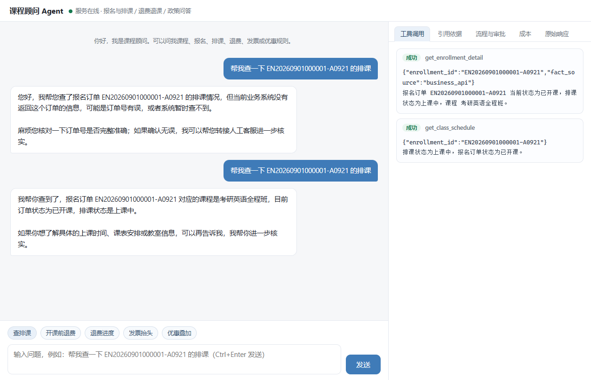
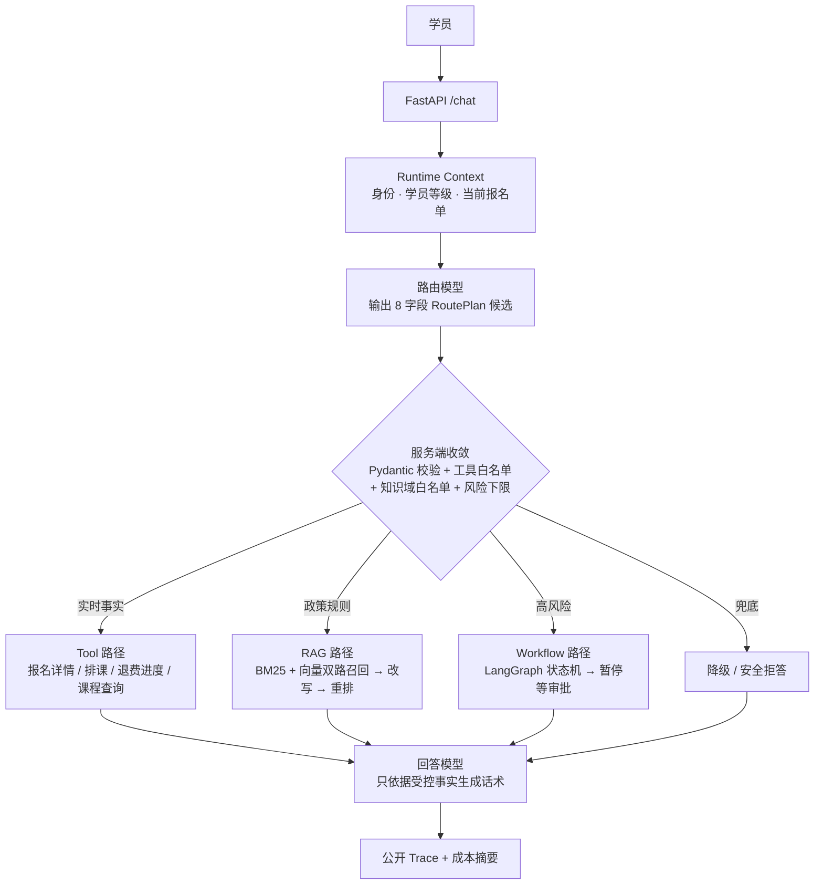
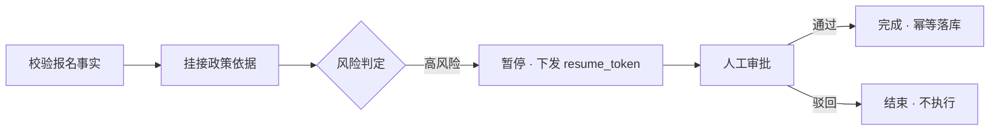

# 课程顾问 Agent

面向在线教育咨询与售后场景的智能客服 Agent。学员问课程、查报名与排课、申请退费、问发票和优惠，都由一个 Agent 统一承接；高风险动作必须走人工审批，不允许模型直接承诺。



## 为什么做这个

在线教育客服有三类问题，处理方式完全不同：

| 类型 | 例子 | 做法 |
|---|---|---|
| 实时业务事实 | 我的课什么时候开？退费到哪一步了？ | 调业务工具，不让模型猜 |
| 稳定政策规则 | 开课后能退吗？续报券怎么用？ | 检索知识库，回答带引用 |
| 高风险资金动作 | 我要退费 | 进 Workflow，人工审批后才执行 |

全交给模型会出三种事故：编造开课时间、承诺不该退的费、把审批跳过。这套系统的核心就是**把「模型负责理解、规则守住边界」落成代码**。

## 架构



三条关键设计：

1. **路由只出候选，执行权在服务端。** 模型输出的 RoutePlan 只是候选，工具名、知识域、风险等级都要过白名单和风险下限；退费、退课这类意图由确定性守卫判定。
2. **检索不到就拒答。** 证据分数不足时明确告知「没有可靠依据」并转人工，不编活动规则、不编退费口径。
3. **高风险流程显式状态机化。** 退费走 LangGraph，命中风险节点就暂停、下发恢复令牌；恢复时复核冻结字段，重复提交靠幂等键挡住。

## 四个技术亮点

### 1. 检索质量治理（Hybrid RAG）

规则路由 + 预检索 + 工具化二次检索三层串联。6 份退费、续报券、发票政策按语义段落切片，附生效时间与知识域元数据；BM25 与向量双路召回后重排；证据分低于阈值不硬答，改为转人工；每轮回答带 citation 与检索阶段标记。

### 2. 高风险流程状态机（LangGraph + HITL）

开课前退费、开课后 7 天退课编排为显式状态机：



Agent 只能提交申请，不能执行资金动作。

### 3. 回归评测（Trace + Eval）

15 条用例覆盖报名查询、排课、退费、退课、发票、降级与安全拒答；每条从五个维度断言：回答内容、工具调用、引用来源、Trace 事件、会话状态。改 Prompt 或检索参数后必跑。

接入真实模型后在线通过率：**15 / 15**。

### 4. 上下文工程（Context Engineering）

按运行时上下文、短期记忆、历史消息分层组装模型输入；历史与工具结果先压缩脱敏再进上下文；用轻 / 重路径控制上下文预算，超预算时先裁历史、再裁工具摘要，避免关键事实被挤掉。

## 实测数据

| 项 | 结果 | 怎么得到的 |
|---|---|---|
| 回归用例通过率 | 15 / 15 | `/eval/run`，模型在线 |
| 高风险请求被直接执行 | 0 / 5 | 构造 5 条「马上退费」请求，全部进审批或先澄清单号 |
| 业务后端故障时编造事实 | 0 / 4 | 停掉教务服务，4 类查询全部转澄清或说明 |
| 业务工具 | 4 个 | 报名详情 / 排课 / 退费进度 / 课程查询 |
| 政策知识 | 6 条 | 退费、退课、开学季优惠、续报券、发票抬头、开票时效 |

## 能力边界

- 不接真实支付与真实教务系统，业务事实来自独立的 mock 教务服务。
- 退费只做到「提交审批 + 记录结果」，不触发真实资金动作。
- 知识库是 6 条政策样本，不是全量教务规则。
- 本仓库只包含项目说明、架构图与演示材料，Agent 核心实现不随仓库分发。

## 技术栈

Python · FastAPI · LangChain · LangGraph · Pydantic · Chroma · BM25 · DeepSeek

## 关于源码

本仓库提供项目说明、架构图与演示材料；Agent 核心实现不随仓库分发。

仓库内含项目中自研的教务 mock 服务（`code-samples/mock-academic/`），约 160 行 FastAPI 实现，包含 4 个只读接口、种子数据与 Pydantic 校验，可直接运行：

```bash
cd code-samples/mock-academic
pip install fastapi uvicorn
python main.py     # http://127.0.0.1:8081
```
